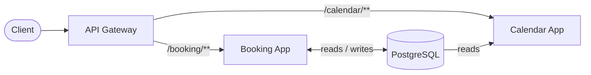
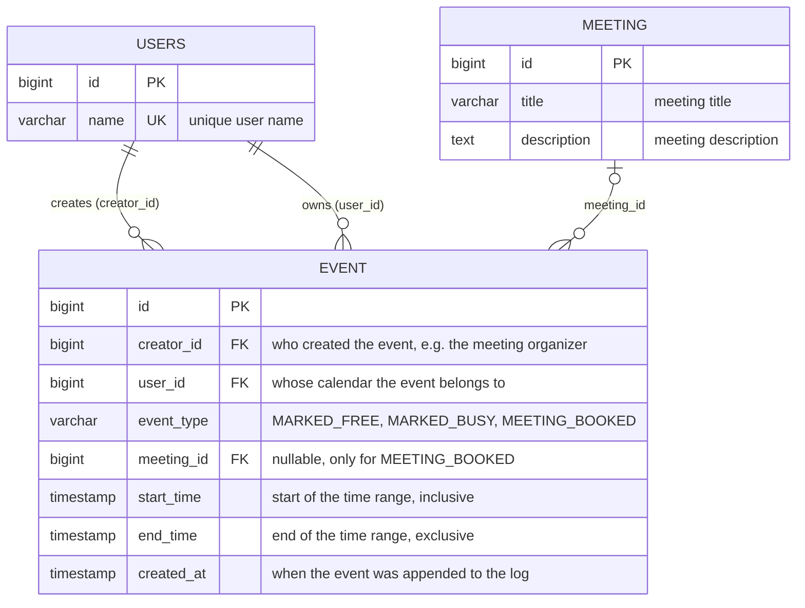

## Assumptions and constraints
- Security is out of scope
- Timezones are out of scope
- One user - one calendar
- Time quantum is 15 min
- No meeting confirmation
- Meetings cannot be cancelled or modified
- `Busy` looks the same as `no slot` in calendar
- The API is command-based, not CRUD: every change is a `POST` that appends events to the log,
  there are no `PUT` / `DELETE`. Slots have no ids, a slot is an interval in the `FREE` state:
  to delete a slot, mark its interval as busy;
  to modify a slot, mark the old interval as busy and the new one as free
- The start is included, the end is not. So `[13:00, 13:30)` and `[13:30, 14:00)` do not overlap
- Events that change nothing (e.g. `MARKED_FREE` on already free time) are still appended to the log

## Landscape



- **Booking App** (write side) - creates users and books all kinds of events. Validates every
  requested event against the booking rules and changes the data only if the event is applicable.
- **Calendar App** (read side) - read-only; shows users' calendars, i.e. the resulting projection
  of all booked events. Never modifies data.

## Database schema



Constraints (time quantum is 15 min):
- `end_time > start_time`
- `start_time` and `end_time` are aligned to 15 minutes: minutes are a multiple of 15,
  seconds and fractions are zero, e.g.
  `CHECK (extract(minute from start_time)::int % 15 = 0 AND date_trunc('minute', start_time) = start_time)`
  (same for `end_time`)

Indexes:
- `(user_id, start_time)` - main Calendar App query: events of a user within a time frame
  (`WHERE user_id = ? AND start_time < :end_time AND end_time > :start_time`)
- `(meeting_id)` - find all events (participants' calendars) of a meeting

## API

API fields are camelCase (`startTime`), database columns are snake_case (`start_time`).

### Booking App

| endpoint                        | parameters                                               | result                                                                                                                                      |
|---------------------------------|----------------------------------------------------------|---------------------------------------------------------------------------------------------------------------------------------------------|
| `POST /booking/users`                   | `name`                                                   | new `User`                                                                                                                                  |
| `POST /booking/users/{userId}/free`     | `startTime`, `endTime`                                 | creates 1 event `MARKED_FREE` (`user_id = creator_id = userId`)                                                                             |
| `POST /booking/users/{userId}/busy`     | `startTime`, `endTime`                                 | creates 1 event `MARKED_BUSY` (`user_id = creator_id = userId`)                                                                             |
| `POST /booking/users/{userId}/meetings` | `title`, `description`, `participantIds`, `startTime`, `endTime` | new `Meeting` (returns `meetingId`) + appends N events `MEETING_BOOKED`, one per participant incl. the organizer (`user_id` = participant, `creator_id = userId`) |

### Calendar App

| endpoint                       | parameters              | result                                                                                                  |
|--------------------------------|-------------------------|---------------------------------------------------------------------------------------------------------|
| `GET /calendar/users/{userId}`          | `startTime`, `endTime` (optional) | user (`id`, `name`) and user's calendar (projection of the event log) for `[startTime, endTime)`: list of intervals with their time state |
| `GET /calendar/meetings/{meetingId}`    | -                       | meeting (`title`, `description`, participants)                                                          |

## Event types and time states

| event type       | meaning                                             |
|------------------|-----------------------------------------------------|
| `MARKED_FREE`    | the interval is free                                |
| `MARKED_BUSY`    | the interval is busy                                |
| `MEETING_BOOKED` | a meeting (`meeting_id`) was booked on the interval |

| time state | meaning               |
|------------|-----------------------|
| `FREE`     | available             |
| `BUSY`     | not available         |
| `MEETING`  | occupied by a meeting |

### Projection

Events are applied in log order (by `id`): each event sets its time state on its interval and
overrides earlier events there. Time not covered by any event is `BUSY`.

Example:

```mermaid
gantt
    dateFormat HH:mm
    axisFormat %H:%M
    todayMarker off

    section Events
    1 MARKED_FREE    :active, 09:00, 12:00
    2 MARKED_BUSY    :done,   10:00, 10:30
    3 MEETING_BOOKED :crit,   11:00, 12:00

    section Projection
    FREE             :active, 09:00, 10:00
    BUSY             :done,   10:00, 10:30
    FREE             :active, 10:30, 11:00
    MEETING          :crit,   11:00, 12:00
    BUSY             :done,   12:00, 13:00
```



## Booking rules

### General rules

1. `start_time` and `end_time` are aligned to the 15 min quantum, `end_time > start_time`
2. `start_time` is later than the current time
3. User `userId` exists
4. For a meeting: all participants exist; the organizer (`userId`) is added as a participant automatically

### State transitions

| event type       | rule                                                    |
|------------------|---------------------------------------------------------|
| `MARKED_FREE`    | the interval has no meetings                            |
| `MARKED_BUSY`    | the interval has no meetings                            |
| `MEETING_BOOKED` | the interval is entirely `FREE` for every participant   |

## Concurrency

Use pessimistic locking on the `users` rows:

```sql
SELECT id FROM users WHERE id IN (:userIds) ORDER BY id FOR UPDATE;
```
